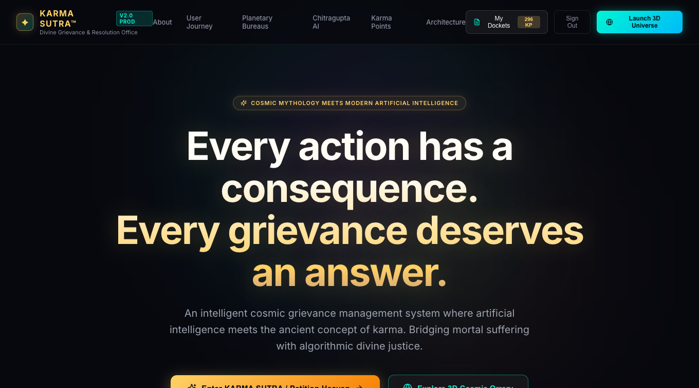
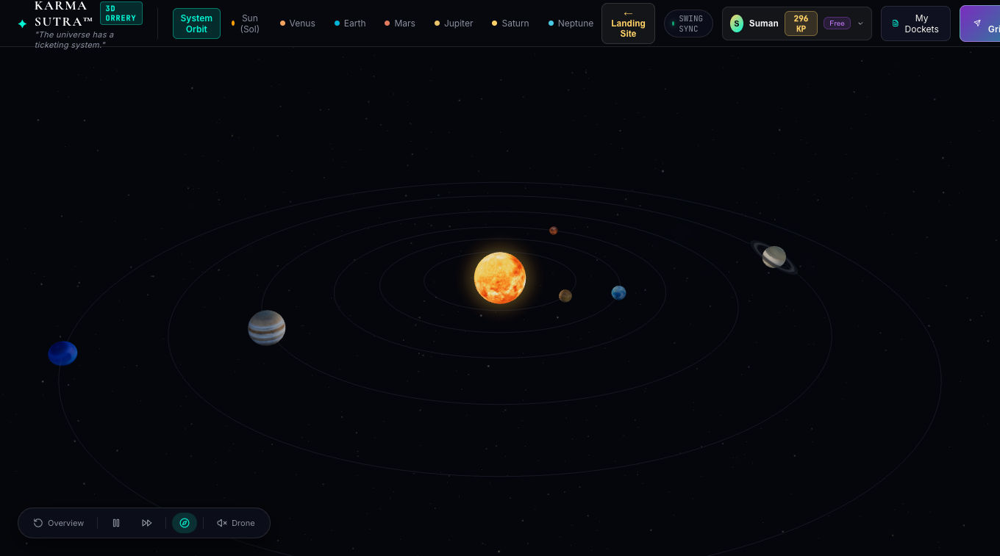
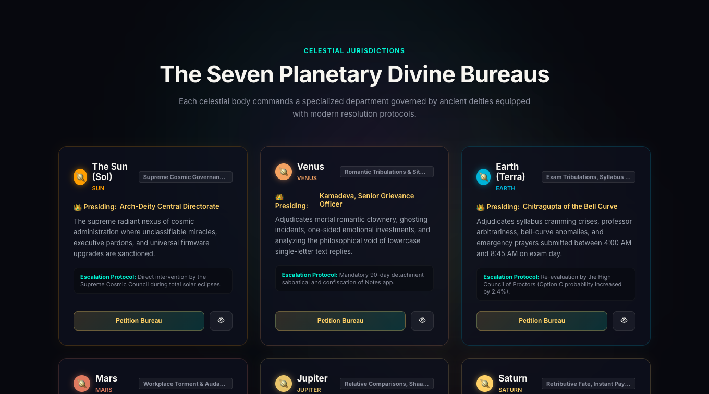
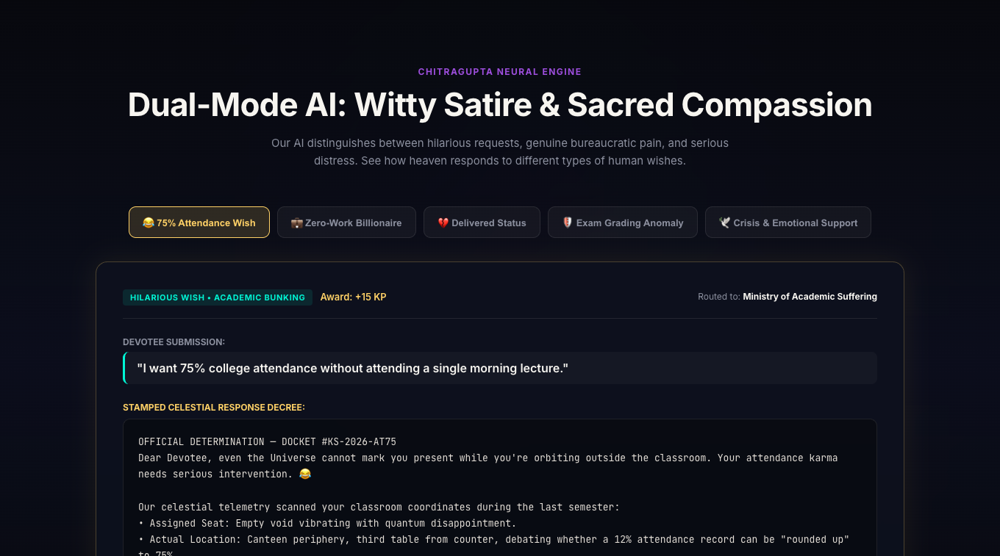
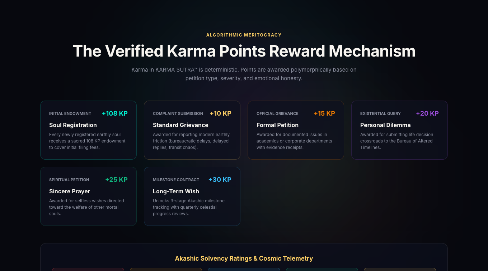
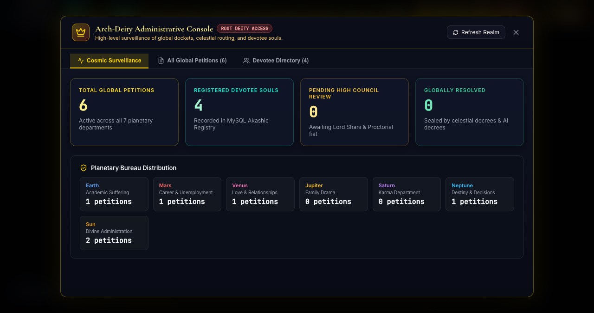

# ✦ KARMA SUTRA™
### Intelligent Cosmic Grievance Management System & 3D Celestial Orrery
> *"Every action has a consequence. Every grievance deserves an answer."*  
> *"The universe has a ticketing system."*

[](https://vanshikab16.github.io/karma-sutra/)
[](https://vanshikab16.github.io/karma-sutra/)
[](Final%20Report.pdf)

[](https://www.oracle.com/java/)
[](https://threejs.org/)
[](https://react.dev/)
[](https://www.mysql.com/)
[](https://tailwindcss.com/)
[](https://www.docker.com/)
[](LICENSE)

---

### 🌐 Permanent Live Web Deployment & Documentation
> **Access the live permanent web product anytime from any device or browser without running localhost:**  
> 🔗 **[https://vanshikab16.github.io/karma-sutra/](https://vanshikab16.github.io/karma-sutra/)**  
>  
> **Official ADS Final Project Report:**  
> 📄 **[Final Report.pdf (Open on GitHub)](./Final%20Report.pdf)** | **[Direct Download](https://raw.githubusercontent.com/VanshikaB16/karma-sutra/main/Final%20Report.pdf)**

---

## 1. Project Overview

**KARMA SUTRA™** is an enterprise-grade, full-stack satirical grievance management platform that humorously reimagines divine intervention, existential dilemmas, mundane complaints, and heartfelt prayers through the lens of modern corporate bureaucracy.

Bridging ancient dharmic mythology with artificial intelligence, mortal prayers are ingested as polymorphic support tickets, karma points function as an immutable Akashic credit ledger, and the cosmos operates with departmental routing, SLA response timelines, escalation dockets, and an interactive **Three.js WebGL 3D Solar System**.

Authored by **Vanshika Bishnoi**, this project is engineered to production startup standards and architected for academic defense in **Object-Oriented Programming Systems (OOPS)** and **Advanced Data Structures (ADS)**.

---

## 2. System Architecture

KARMA SUTRA™ features a hybrid architecture combining an asynchronous Java backend with an embedded web server, a WebGL 3D client, a desktop Java Swing client, and a relational MySQL ledger:

```
┌────────────────────────────────────────────────────────────────────────┐
│                        USER & DEVOTEE CLIENTS                          │
│                                                                        │
│   ┌──────────────────────────────┐    ┌────────────────────────────┐   │
│   │ 3D Cosmic Web Client (React) │    │  Java Swing Desktop Client │   │
│   │   Three.js + Tailwind CSS    │    │  FlatLaf Dark + Custom 2D  │   │
│   └──────────────┬───────────────┘    └──────────────┬─────────────┘   │
└──────────────────┼───────────────────────────────────┼─────────────────┘
                   │ HTTP / REST                       │ In-Memory Call
                   ▼                                   ▼
┌────────────────────────────────────────────────────────────────────────┐
│                   JAVA BACKEND APPLICATION (JDK 21)                    │
│                                                                        │
│  ┌──────────────────────────────────────────────────────────────────┐  │
│  │ CosmicWebServer (Embedded JDK HttpServer - Ports 8108 & 5173)    │  │
│  │ Endpoints: /api/status, /api/auth/*, /api/dockets, /api/admin/*  │  │
│  └──────────────────────────────────┬───────────────────────────────┘  │
│                                     │                                  │
│  ┌──────────────────────────────────▼───────────────────────────────┐  │
│  │ Core Service Layer:                                               │  │
│  │ • ComplaintService (Polymorphic Factory & Ticket Lifecycle)      │  │
│  │ • DivineResponseService (Multi-Provider AI Orchestration)        │  │
│  │ • KarmaService (Ledger Calculations & Solvency Ratings)          │  │
│  │ • AuthService (PBKDF2 Hashing, Session Gatekeeper)               │  │
│  │ • SubscriptionService (Tier Upgrades & Simulated UPI)            │  │
│  └──────────────────────────────────┬───────────────────────────────┘  │
│                                     │                                  │
│  ┌──────────────────────────────────▼───────────────────────────────┐  │
│  │ Multi-Provider AI Engine Layer:                                  │  │
│  │ • GeminiProvider (Google Gemini 1.5 Flash via REST)              │  │
│  │ • GroqProvider (Groq Llama-3 70B via High-Speed REST)             │  │
│  │ • CosmicResilientProvider (Local Synthesis & Humour Engine)      │  │
│  └──────────────────────────────────┬───────────────────────────────┘  │
│                                     │ JDBC Connection Pool             │
└─────────────────────────────────────┼──────────────────────────────────┘
                                      ▼
┌────────────────────────────────────────────────────────────────────────┐
│                 RELATIONAL DATABASE (MySQL 8.0)                        │
│                                                                        │
│  9 Relational Tables:                                                  │
│  users, departments, complaints, complaint_responses,                 │
│  complaint_status_history, karma_transactions, subscriptions,         │
│  simulated_payments, wish_milestones                                   │
└────────────────────────────────────────────────────────────────────────┘
```

---

## 3. Key Features

### 🌟 1. Professional Startup Landing Website
* **Cosmic Mythology Meets Modern Tech**: Sleek obsidian and antique gold aesthetic with starry ambient glows and micro-interactions.
* **Six-Stage User Journey**: Explains mortal soul attestation, polymorphic filing, AI classification, department routing, karma reward, and celestial decrees.
* **Interactive AI Humour Showcase**: Live demo tabs showing the difference between hilarious wish roasts, career decrees, romantic dilemmas, serious academic audits, and crisis care.
* **One-Click Universe Launch**: Seamless transition between the landing website and the 3D celestial canvas.

### 🪐 2. Interactive 3D Cosmic Orrery (Three.js WebGL)
* **Photorealistic Astronomical Textures**: NASA-sourced high-resolution surfaces for Earth (continents, night lights, and cloud alpha layer), Jupiter (Great Red Spot & cream/orange bands), Saturn (semi-transparent light-responsive rings), Mars (bump-mapped rust terrain), Venus, Neptune, and an animated emissive Sun.
* **Camera Tweening & Orbital Mechanics**: Raycasting planet selection smoothly zooms camera coordinates to inspect individual planetary departments.
* **Custom GLSL Shaders**: Atmospheric rim-lighting shaders responding dynamically to solar illumination.

### 🏛️ 3. Seven Planetary Divine Bureaus
| Planet | Department Code | Bureau Name | Presiding Deity | Domain & Responsibilities |
| :--- | :--- | :--- | :--- | :--- |
| ☀️ **Sun** | `DEPT_ADMIN` | Supreme Council of Divine Administration | Arch-Deity Central Directorate | Universal firmware upgrades, meta-appeals, executive pardons. |
| 🌍 **Earth** | `DEPT_ACAD` | Ministry of Academic Suffering | Chitragupta of the Bell Curve | 8:00 AM lectures, 75% attendance despair, exam anxiety, thesis crises. |
| 🔴 **Mars** | `DEPT_CAREER` | Ministry of Corporate Karmic Balancing | Lord Shani, Lead SCRUM Master | Toxic sprint cycles, unread resumes, LinkedIn cringe, appraisal delays. |
| 💖 **Venus** | `DEPT_LOVE` | Bureau of Unrequited Affection & Ghosting | Kamadeva, Senior Grievance Officer | Delivered without reply, dating app burnout, situationships. |
| ⚡ **Jupiter** | `DEPT_FAMILY` | High Tribunal of Domestic Drama | Council of Matriarchs & Elders | Relative comparisons, WhatsApp forwards, unsolicited career advice. |
| 🪐 **Saturn** | `DEPT_KARMA` | Supreme Department of Retributive Karma | Dharmaraja Yama, Chief Justice | Payback against microwave fish heaters and traffic queue cutters. |
| 🌊 **Neptune** | `DEPT_DESTINY` | Bureau of Altered Timelines & Decisions | Lord Shiva / Lord Brahma | Alternate universe regrets, career pivot simulations, life crossroads. |

### 🤖 4. Intelligent Humour & Classification Engine
* **Hilarious Wish Roasting**: Context-aware satirical decrees (e.g., reminding attendance bunk petitioners that quantum physics allows entanglement, but not proxy signatures in Engineering Math).
* **Serious Grievance Handling**: Automatically suspends satirical protocols when detecting genuine injustice (e.g. grading anomalies or workplace harassment), issuing actionable proctorial audit notices.
* **Sacred Compassion Protocol**: Crisis submissions trigger a zero-sarcasm sacred safety protocol offering direct integration with verified emergency helplines (988, Tele-MANAS, Vandrevala Foundation).

### ⚖️ 5. Gamified Karma Accounting & Solvency Tiers
* **Polymorphic Rewards**:
  * Soul Registration: **+108 KP** (Initial endowment)
  * Standard Complaint: **+10 KP**
  * Formal Grievance: **+15 KP**
  * Personal Dilemma: **+20 KP**
  * Sincere Prayer: **+25 KP**
  * Long-Term Wish: **+30 KP** (Unlocks 3-year milestone roadmap)
* **Solvency Telemetry**:
  * 👑 **Enlightened VIP** (`> 500 KP`): Celestial fast-track and priority parking.
  * 🌟 **Solvent Devotee** (`200 - 500 KP`): Clean Akashic audit without reincarnation penalties.
  * ⚖️ **Standard Earthling** (`100 - 199 KP`): Moderate solvency; warned against family group drama.
  * ⚠️ **Low Liquidity** (`50 - 99 KP`): Must perform one unconditional earthly good deed.
  * ⛔ **Karmic Overdraft** (`< 50 KP`): Immediate audit recommended; return borrowed Tupperware.

### 👑 6. Arch-Deity Sovereign Admin Console
* **Global Telemetry**: Real-time surveillance over all planetary departments, registered mortal souls, and total karma treasury in circulation.
* **Cross-Devotee Triage Matrix**: Search, filter, and inspect grievances across all devotees on Earth.
* **Divine Fiat Decrees**: Update docket status directly (`Under Divine Review`, `Resolved by Heaven`, `Forwarded to Karma`).
* **Akashic Soul Directory & Grant Karma**: Discretionary karma endowment tool directly connected to MySQL.

---

## 4. Visual Application Showcase

| Landing Website Hero & Navigation | Interactive 3D Cosmic Orrery |
| :---: | :---: |
|  |  |

| Planetary Divine Bureaus | Chitragupta Neural AI Showcase |
| :---: | :---: |
|  |  |

| Karma Points Economy | Arch-Deity Sovereign Console |
| :---: | :---: |
|  |  |

---

## 5. Academic Evaluation & OOPS / ADS Defense

This codebase was crafted to exemplify fundamental Computer Science concepts:

1. **Polymorphic Inheritance Hierarchy**:
   * Abstract base class `Complaint` extended by concrete models: `Grievance`, `Wish`, `Prayer`, and `PersonalDilemma`.
   * Dynamic dispatch for `calculateKarmaWeight()` ensuring runtime polymorphism.
2. **Design Patterns**:
   * **Factory Pattern** (`ComplaintFactory`): Encapsulates object creation based on `ComplaintType`.
   * **Strategy Pattern** (`LLMProvider`): Swappable AI implementations (`GeminiProvider`, `GroqProvider`, `CosmicResilientProvider`).
   * **Data Access Object (DAO) Pattern**: Clean separation of persistence across 8 DAOs with parameterized SQL preventing SQL injection.
   * **Audit Trail Pattern**: `complaint_status_history` tracks state transitions with timestamps and modifying entities.
3. **Data Structures**:
   * Thread-safe connection pools, hash indexing on ticket numbers, logarithmic lookup on user credentials, and relational foreign-key referential integrity.

---

## 6. Technology Stack Inventory

| Component | Technology | Version | Purpose |
| :--- | :--- | :--- | :--- |
| **Backend Core** | Java (OpenJDK) | 21 LTS | Business logic, polymorphic domain model, multithreaded daemon |
| **Build Tool** | Apache Maven | 3.9+ | Dependency resolution, shaded uber-jar packaging |
| **Relational DB** | MySQL | 8.0+ | Persistent storage, ACID transactions, 9 relational tables |
| **3D Engine** | Three.js | 0.169.0 | WebGL solar system, orbit mechanics, GLSL shaders |
| **Frontend UI** | React & TypeScript | 18.3.1 / 5.6 | Reactive UI, state machine, landing website, modals |
| **Styling** | Tailwind CSS / CSS3 | 4.3 | Responsive grid, celestial dark mode, glassmorphism |
| **Bundler** | Vite | 5.4 | Fast HMR dev server & optimized production asset rollup |
| **Desktop GUI** | Java Swing & FlatLaf | 3.4.1 | Native desktop client with celestial dark palette |
| **AI LLM** | Google Gemini / Groq | 1.5 Flash | Natural language classification & humorous synthesis |
| **Containerization**| Docker & Compose | Multi-Stage | Production deployment orchestration |

---

## 7. Quickstart & Installation

### Option A: One-Command Docker Deployment (Recommended)
Ensure you have Docker and Docker Compose installed:

```bash
# 1. Clone the repository
git clone https://github.com/VanshikaB16/karma-sutra.git
cd karma-sutra

# 2. Configure environment variables (optional for local mode)
cp .env.example .env

# 3. Spin up the complete stack (MySQL + Java Backend + 3D Frontend)
docker compose up --build
```
Open your browser at **[http://localhost:8108/](http://localhost:8108/)** or **[http://localhost:5173/](http://localhost:5173/)**.

---

### Option B: Native Local Setup

#### Prerequisites
* **Java 21 LTS** (`java -version`)
* **Maven 3.9+** (`mvn -v`)
* **Node.js 20+** & **npm** (`node -v`)
* **MySQL 8.0+** running on port `3307` (or port `3306` configured in `.env`)

#### Step 1: Initialize Database
```bash
# Start MySQL or use the included orchestrator script:
./scripts/start-db.sh

# The database schema (sql/schema.sql) will automatically migrate on startup.
```

#### Step 2: Build Frontend
```bash
cd cosmic-3d
npm install
npm run build
cd ..
```

#### Step 3: Compile & Run Backend
```bash
mvn clean package -DskipTests
java -jar target/karma-sutra-app-1.0.0.jar
```

Access the application in your browser:
* **Landing Page & 3D Web App:** [http://localhost:8108/](http://localhost:8108/)
* **Java Swing Desktop App:** Launches automatically when running `Main.java` in desktop mode.

---

## 8. Default Credentials & Role Matrix

| Role | Username | Password | Privileges |
| :--- | :--- | :--- | :--- |
| **Normal Devotee** | `Vanshika` | `Devotee@108` | Personal 108 KP balance, "My Dockets", file petitions, view divine replies |
| **Arch-Deity Admin** | `admin` | `CosmicAdmin@108` | 9,999 KP treasury, global surveillance KPIs, all mortals' triage, divine fiat controls, soul directory & grant karma |

*(You can also register any new soul directly from the landing website with instant +108 KP endowment.)*

---

## 9. REST API Reference

| Method | Endpoint | Access | Description |
| :--- | :--- | :--- | :--- |
| `GET` | `/api/status` | Public | System status, database health, and active session |
| `GET` | `/api/departments` | Public | List of 7 planetary divine departments |
| `POST` | `/api/auth/register` | Public | Register new earthly soul with 108 initial Karma Points |
| `POST` | `/api/auth/login` | Public | Authenticate devotee or sovereign administrator |
| `POST` | `/api/auth/logout` | Devotee | Invalidate session and depart Celestial Realm |
| `POST` | `/api/submit-grievance`| Devotee | Submit petition, trigger AI classification & decree |
| `GET` | `/api/dockets` | Devotee | Retrieve user's personal filed petitions |
| `GET` | `/api/auth/karma-ledger`| Devotee | Retrieve immutable transaction history & balance |
| `GET` | `/api/admin/overview` | Admin Only | Global KPI surveillance metrics across Heaven |
| `GET` | `/api/admin/all-dockets`| Admin Only | Triage desk containing all mortal petitions across Earth |
| `POST` | `/api/admin/update-status`| Admin Only | Divine fiat docket status decree |
| `POST` | `/api/admin/grant-karma` | Admin Only | Bestow discretionary karma points in MySQL |

---

## 10. Security & Production Hardening

* **Password Protection**: Passwords are salted with per-user 64-character random cryptographic salts and hashed via `PBKDF2WithHmacSHA256` (10,000 iterations). Plaintext passwords are never stored.
* **SQL Injection Immunity**: 100% of SQL queries across all 8 DAOs use JDBC `PreparedStatement` with parameterized placeholders.
* **Devotee Data Isolation**: Devotees can only access tickets matching `WHERE user_id = ?`. Cross-tenant leaks are physically blocked at the database level.
* **Admin Gatekeeping**: Administrative endpoints strictly enforce role checking (`user.isAdmin()`) and reject unauthorized access with HTTP 403 Forbidden.
* **Zero Credential Exposure**: `.gitignore` comprehensively filters all `.env` files, database dumps, sockets, and private keys.

---

## 11. Author & Academic Defense Notice

* **Author:** Vanshika Bishnoi
* **Academic Course:** Object-Oriented Programming Systems (OOPS) & Advanced Data Structures (ADS)
* **Evaluation Focus:** Polymorphic Factory Design, Strategic Multi-Provider AI Fallback, Relational Integrity, 3D WebGL Visualization.
* **GitHub Repository:** [https://github.com/VanshikaB16/karma-sutra](https://github.com/VanshikaB16/karma-sutra)

---

## 12. License

This project is licensed under the **MIT License** — see the [LICENSE](LICENSE) file for details.

*(C) 2026 KARMA SUTRA™ — "The universe has a ticketing system."*
